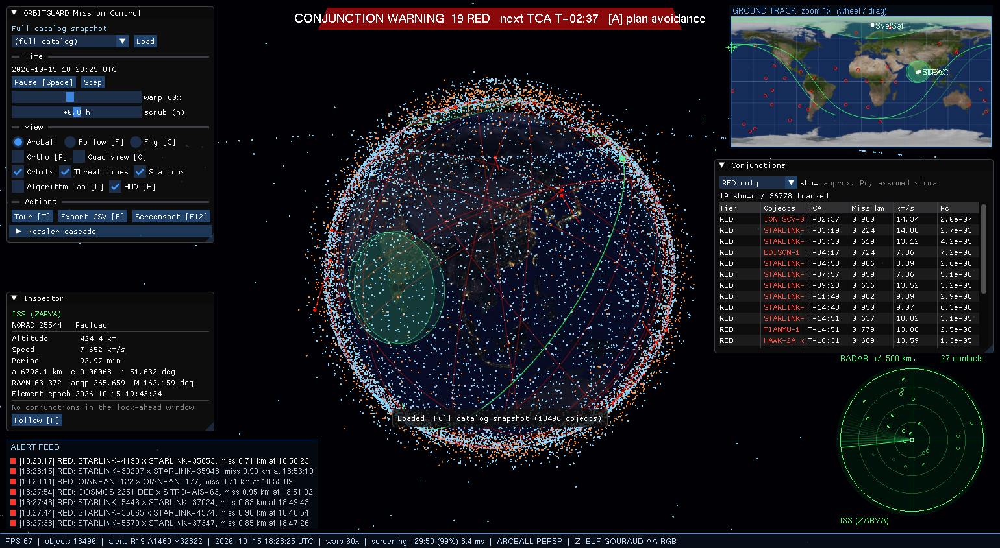
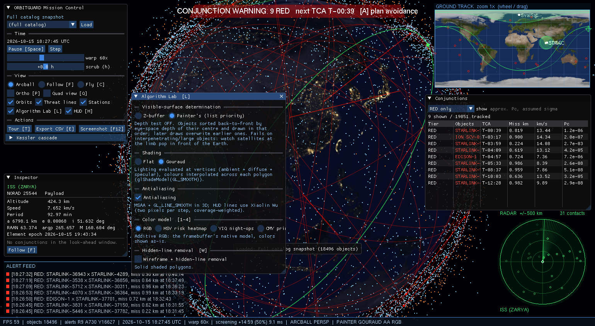
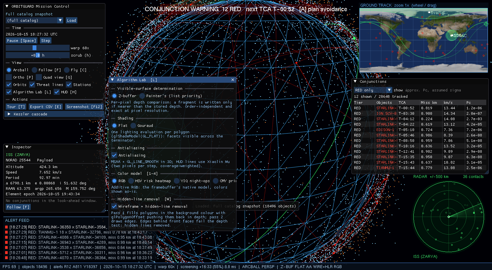
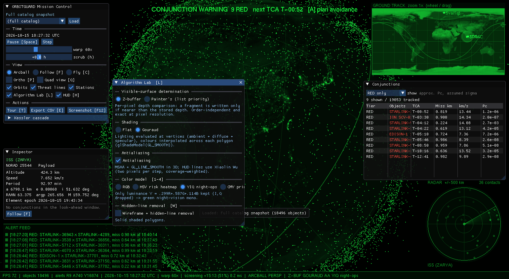
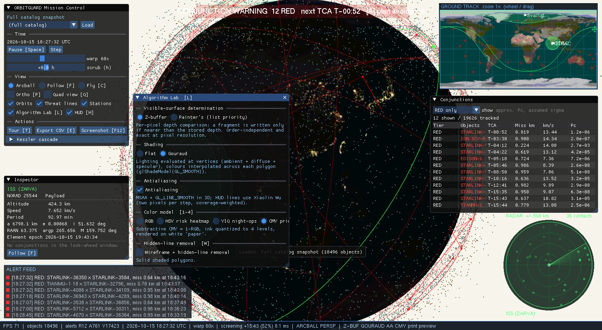
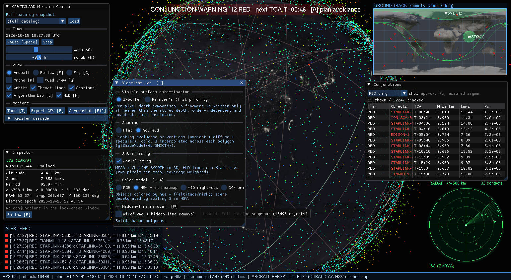
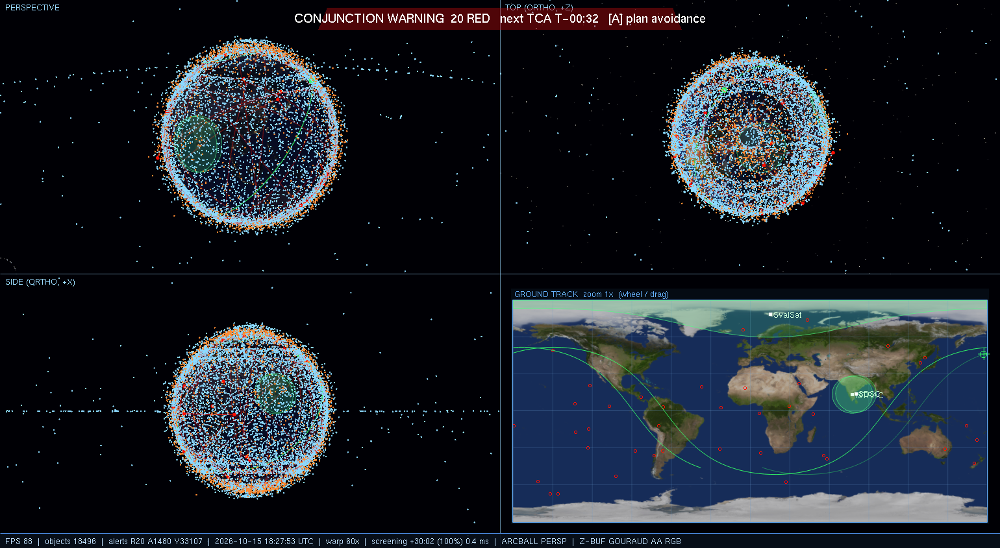
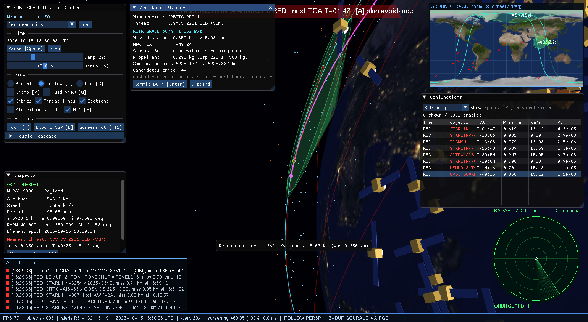
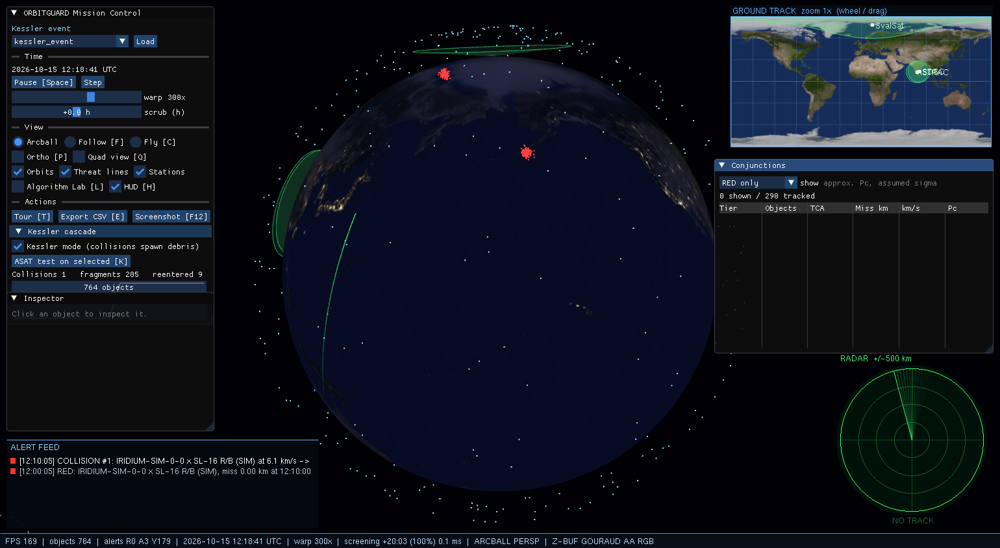

# ORBITGUARD
### Real-time Space Situational Awareness console: 3D orbits, debris conjunctions, collision avoidance


C++17 · OpenGL (fixed function) · freeGLUT · Dear ImGui · CMake



ORBITGUARD loads a real snapshot of **18,496 tracked objects** (CelesTrak TLEs). It propagates them with
Kepler + J2, screens every pair for close approaches in real time, plans the minimum-Δv avoidance
burn when a threat appears, and simulates Kessler debris cascades. It is laid out like a satellite
operator's mission-control screen.

The textbook graphics algorithms in it are **implemented by hand**, and the **Algorithm Lab** lets
you switch between them while the scene is running:

| Algorithm | Where it is used |
|---|---|
| Own 4×4 homogeneous matrices | All transforms |
| Midpoint line and circle | HUD |
| Scan-line polygon fill | HUD panels and footprints |
| Cohen-Sutherland line clipping | Ground-track minimap |
| Sutherland-Hodgman polygon clipping | Ground-track minimap |
| Xiaolin Wu antialiased lines | HUD |
| RGB/HSV/YIQ/CMY color models | Algorithm Lab color modes |
| Bezier and B-spline curves | Maneuver arc, camera tour |
| Fractal meshes | Debris shapes |
| Z-buffer vs painter's algorithm | Algorithm Lab |
| Flat vs Gouraud shading | Algorithm Lab |
| Hidden-line removal | Algorithm Lab |
| Color-ID picking | Clicking objects |

> **Honesty note:** propagation is simplified Kepler + J2 secular drift, not full SGP4. The collision
> probability is an approximate Gaussian estimate with an assumed covariance. The risk-tier
> thresholds are demo-scaled and configurable. This is an educational visualizer, not an
> operational tool.

---

## Contents
1. [Quick start (3 commands)](#1-quick-start)
2. [Requirements and first-time setup](#2-requirements-and-first-time-setup)
3. [Building](#3-building)
4. [Running](#4-running)
5. [A 5-minute demo walkthrough](#5-a-5-minute-demo-walkthrough)
6. [Controls](#6-controls)
7. [The screen, piece by piece](#7-the-screen-piece-by-piece)
8. [Scenarios](#8-scenarios)
9. [Algorithm Lab](#9-algorithm-lab)
10. [Command-line options](#10-command-line-options)
11. [Configuration (`config.json`)](#11-configuration-configjson)
12. [Tests and self-checks](#12-tests-and-self-checks)
13. [Measured performance](#13-measured-performance)
14. [Syllabus coverage map](#14-syllabus-coverage-map-cs3002-1)
15. [How it works](#15-how-it-works)
16. [Project layout](#16-project-layout)
17. [Refreshing the TLE catalog](#17-refreshing-the-tle-catalog)
18. [Troubleshooting](#18-troubleshooting)
19. [Limitations and future work](#19-limitations-and-future-work)
20. [Credits](#20-credits)

---

## 1. Quick start

Open **PowerShell** in the project folder (`C:\Projects_2027\Orbitguard`) and run:

```powershell
$env:Path = "C:\Program Files\Microsoft Visual Studio\18\Community\Common7\IDE\CommonExtensions\Microsoft\CMake\CMake\bin;" + $env:Path
cmake -S . -B build -G "Visual Studio 18 2026" -A x64
cmake --build build --config Release
.\build\Release\orbitguard.exe
```

**Using Git Bash instead of PowerShell?** The syntax is different: `export` instead of `$env:`,
and forward slashes in paths. Run this instead:

```bash
export PATH="/c/Program Files/Microsoft Visual Studio/18/Community/Common7/IDE/CommonExtensions/Microsoft/CMake/CMake/bin:$PATH"
cmake -S . -B build -G "Visual Studio 18 2026" -A x64
cmake --build build --config Release
./build/Release/orbitguard.exe
```

> Pasting the PowerShell block into Git Bash fails with `bash: :Path: command not found` and
> `bash: .buildReleaseorbitguard.exe: command not found`, because bash treats `\` as an escape
> character. Use the block that matches your shell.

The first configure takes about a minute because it downloads freeGLUT, Dear ImGui, GLM and
nlohmann/json. Once the build has finished, you only need the last line to launch the program.
In Git Bash, the other examples in this README also need forward slashes, for example
`./build/Release/orbitguard.exe --scenario scenarios/leo_near_miss.json`.

---

## 2. Requirements and first-time setup

| Need | Version used | Notes |
|---|---|---|
| Windows | 10 / 11 (x64) | Linux should work through CMake, but it has not been verified |
| Visual Studio | **2026 Community (v18)** or 2022 | Workload **"Desktop development with C++"** (MSVC, Windows SDK, bundled CMake) |
| CMake | ≥ 3.20 | Bundled with Visual Studio, so nothing extra to install |
| Internet | first configure only | CMake FetchContent downloads the dependencies once |
| GPU | any OpenGL 2.1+ driver | Tested on AMD Radeon integrated graphics |

**Do not install** freeGLUT, ImGui or GLM yourself. CMake downloads pinned versions automatically:

| Dependency | Version | Delivered by |
|---|---|---|
| freeGLUT | 3.6.0 (static) | FetchContent |
| Dear ImGui | v1.91.9 | FetchContent |
| GLM | 1.0.1 (tests only) | FetchContent |
| nlohmann/json | 3.11.3 | FetchContent |
| stb_image / stb_image_write | n/a | Vendored in `external/stb` |

The data ships in the repository, so the program runs **fully offline** after the first build:
- `data/catalog.tle`: 18,496 objects (CelesTrak `stations`, `active`, `fengyun-1c-debris`, `cosmos-2251-debris`)
- `assets/textures/earth_day.jpg`, `earth_night.jpg`: 2048×1024

If you use **Visual Studio 2022** instead of 2026, change the generator name to
`"Visual Studio 17 2022"` and the CMake path to `...\Microsoft Visual Studio\2022\Community\...`.

---

## 3. Building

### Option A: command line (recommended)
```powershell
# make the CMake that ships with Visual Studio visible in this shell
$env:Path = "C:\Program Files\Microsoft Visual Studio\18\Community\Common7\IDE\CommonExtensions\Microsoft\CMake\CMake\bin;" + $env:Path

cmake -S . -B build -G "Visual Studio 18 2026" -A x64   # configure (once)
cmake --build build --config Release                    # build (after every code change)
ctest --test-dir build -C Release                       # run the unit tests (optional)
```
The Visual Studio generator finds the compiler on its own, so you don't need a "Developer
PowerShell" or `vcvars`.

### Option B: Visual Studio IDE
1. **File → Open → Folder…** and choose the project folder. Visual Studio detects `CMakeLists.txt`.
2. Set the configuration to **x64-Release**.
3. Choose **orbitguard.exe** as the startup item and press **F5**.

### Build outputs
| File | What it is |
|---|---|
| `build\Release\orbitguard.exe` | The application |
| `build\Release\test_*.exe` | Five self-checking test programs |
| `build\Release\orbitguard_core.lib` | Simulation and algorithm library (no OpenGL) |

---

## 4. Running

```powershell
.\build\Release\orbitguard.exe                                    # full 18,496-object catalog
.\build\Release\orbitguard.exe --scenario scenarios\leo_near_miss.json
.\build\Release\orbitguard.exe --scenario scenarios\kessler_event.json
.\build\Release\orbitguard.exe --scenario scenarios\constellation.json
```

- You can launch it from **any folder**. If `data/`, `assets/`, `scenarios/` and `config.json` aren't
  found relative to the current directory, it falls back to the source folder. That path is baked
  in at compile time.
- A **console window** opens next to the main window. It prints the OpenGL version, scenario loads,
  planner results, export paths and benchmark output.
- You can also switch scenarios from inside the program: Mission Control panel → combo box → **Load**.
- Screenshots (F12) and CSV reports (E) are written to `reports\`.

---

## 5. A 5-minute demo walkthrough

This is a good script for a viva or a demo video.

1. **Launch** `orbitguard.exe`. You see the lit, textured Earth with city lights past the
   terminator, about 18.5k objects, the ground-track minimap, the radar, the alert feed and the
   status bar. The ISS is selected.
2. **Look around.** Left-drag rotates, the scroll wheel zooms, and **left-click** on any dot
   selects it (color-ID picking). The **Inspector** shows its orbit. Press **F** to follow it, and
   **F** again to return.
3. **Time.** Press **+** a few times (warp 60× → 600×), and **Space** to pause and resume.
4. **Load "leo_near_miss"** (Mission Control → combo → Load). A flashing **CONJUNCTION WARNING**
   appears, and the **Conjunctions** table lists `ORBITGUARD-1 × COSMOS 2251 DEB (SIM)` with a
   miss distance of 0.350 km.
5. Press **A**. The **Avoidance Planner** finds a *retrograde 1.262 m/s* burn that raises the miss
   distance from 0.35 km to 5.03 km. On screen you get the old orbit **dashed**, the new orbit
   **solid**, and a **magenta Bezier** transfer arc. The minimap shows the new ground track.
6. Press **Enter** to commit the burn. The feed logs `BURN: …` and the threat disappears.
7. Press **L** to open the **Algorithm Lab**. Toggle Painter's, Flat, Antialiasing, the color
   models (**1–4**) and wireframe hidden-line removal (**W**).
8. Press **Q** for the CAD-style **quad view** (perspective, top, side, ground track).
9. **Load "kessler_event"** and press **+** to reach about 300×. A rocket body strikes a satellite at
   12:10 and about 285 fragments spray out. At 13:55 a fragment hits a second satellite, a chain
   collision. The Kessler panel shows the cascade counter and a population graph.
10. Press **T** for the **cinematic tour** (B-spline camera path) and **E** to export the CSV report.

---

## 6. Controls

### Keyboard
| Key | Action |
|---|---|
| `Space` | Pause / resume |
| `+` / `-` | Time warp up / down (1×, 2×, 5×, 10× … 10,000×) |
| `.` | Single sim step (pauses) |
| `F` | Follow the selected object / back to Earth-centred arcball |
| `C` | Toggle free-fly camera (move with arrow keys, `PgUp`/`PgDn`) |
| `P` | Perspective ⇄ orthographic projection |
| `Q` | Quad-view layout |
| `A` | Plan avoidance (focused conjunction, else the selected object's worst, else the worst overall) |
| `Enter` | Commit the planned burn |
| `K` | ASAT test: destroy the selected object (also switches Kessler mode on) |
| `L` | Algorithm Lab panel |
| `1` `2` `3` `4` | Color model: RGB / HSV heatmap / YIQ night-ops / CMY print |
| `W` | Wireframe with hidden-line removal |
| `T` | Cinematic tour (`Esc` stops it) |
| `E` | Export conjunction report CSV |
| `H` | Hide / show HUD and panels (clean shots) |
| `F12` | Screenshot to `reports\screenshot_<time>.png` |
| `Esc` | Stop the tour, otherwise quit |

### Mouse
| Input | Action |
|---|---|
| Left-drag | Rotate camera (look around in free-fly) |
| Scroll | Zoom |
| Left-click (no drag) | Select the object under the cursor |
| Scroll over the minimap | Zoom the map (1–12×) toward the cursor |
| Drag over the minimap | Pan the map |
| Click a row in **Conjunctions** | Focus that conjunction (pulsing TCA marker, selects the payload) |

When the mouse is over an ImGui panel, the panel gets the input and the 3D view doesn't.

---

## 7. The screen, piece by piece

| Element | What it shows | How it's drawn |
|---|---|---|
| **3D view** | Earth (day texture lit by the sun, city lights blended in past the terminator), starfield, every object as a point colored by type (payload blue, debris orange, rocket body yellow, fragment red). Conjunction objects take a risk color. Nearby objects become satellite meshes or fractal debris rocks (LOD) | OpenGL fixed function, own matrices via `glLoadMatrixd` |
| **Orbits / trail** | Selected object's orbit (green) and fading history trail. Orbits of objects in RED alerts | Line loops sampled from the elements |
| **Threat lines** | A line between the two objects of each alert, colored red→green in HSV by miss distance | `riskColor()` in `color/ColorModels.cpp` |
| **Ground stations** | ISTRAC Bengaluru, SDSC Sriharikota, SvalSat. Dish model, translucent line-of-sight cone, green link when the selected object is above the elevation mask | Depth-sorted translucent cones |
| **Ground-track minimap** (top right) | Selected object's past (dim) and future track, plan track (cyan), station footprints, alert objects | Window→viewport map, dateline split, **Cohen-Sutherland** clipped tracks, **Sutherland-Hodgman** clipped and **scan-line filled** footprints |
| **Radar** (bottom right) | Objects within ±500 km of the selected object in its local horizontal frame. Sweep with afterglow; threats in red | **Midpoint circles** for rings, rotated sweep line (2D homogeneous rotate), window→viewport for blips |
| **Alert feed** (bottom left) | Timestamped RED alerts, collisions, burns | Scan-line filled panel and tier chips |
| **Warning banner** (top) | Flashing when any RED alert is active, with countdown to the next TCA | Scan-line filled trapezoid |
| **Status bar** (bottom) | FPS, live objects, alert counts R/A/Y, sim UTC, warp, screening look-ahead coverage and time, camera mode, Lab state | |
| **Mission Control** panel | Scenario loader, time controls (play, step, warp, ±24 h scrub), view toggles, actions, Kessler controls and population graph | Dear ImGui |
| **Inspector** | NORAD ID, type, altitude, speed, period, a/e/i/Ω/ω/M, element epoch, nearest threat + plan button | Dear ImGui |
| **Conjunctions** | Sortable alert table (filter: ≥ YELLOW / ≥ AMBER / RED only), TCA countdown, miss, relative speed, approx. Pc | Dear ImGui |
| **Avoidance Planner** | Maneuvering object, Δv and direction, old→new miss, closest third object, propellant, semi-major-axis change, Commit / Discard | Dear ImGui |

**Risk tiers** (configurable): **RED** < 1 km, **AMBER** < 5 km, **YELLOW** < 25 km.
On the full catalog the screener tracks tens of thousands of YELLOW encounters (dense Starlink
shells), so the default view shows **RED only**. Change it with the *show* combo in the
Conjunctions panel.

---

## 8. Scenarios

Scenarios are JSON files in `scenarios/`, so demos are reproducible.

| File | What happens | Expected result |
|---|---|---|
| *(none)* | Full catalog snapshot, ISS selected | About 10–40 RED alerts among real objects at any time |
| `leo_near_miss.json` | 4,000-object catalog sample plus **ORBITGUARD-1** (550 km SSO). A Cosmos-2251 fragment crosses at T+50 min with a 350 m radial miss | RED alert at exactly T+3000 s. The planner finds a −1.262 m/s burn → 5.03 km |
| `kessler_event.json` | Two 240-satellite shells (780 km and 800 km). A rocket body hits `IRIDIUM-SIM-0-0` at T+10 min. Kessler mode on, collision distance demo-scaled to 2 km, seed 1957 | Collision #1 → 285 fragments. Chain collision #2 at 13:55 UTC. The same numbers every run |
| `constellation.json` | Two Walker shells (1,584 sats at 550 km/53°, 720 sats at 570 km/70°) over a 6,000-object catalog sample | Screening load in a dense shell; best viewed with HSV heatmap (`2`) |

### Writing your own
```jsonc
{
  "name": "My demo",
  "description": "shown as a tooltip",
  "epoch_utc": "2026-10-15T12:00:00Z",             // optional when a catalog is loaded (median TLE epoch used)
  "catalog": { "path": "data/catalog.tle", "limit": 3000 },   // optional; evenly sampled
  "config": { "kessler": { "enabled": true } },     // overrides any config.json key
  "objects": [ { "name": "SAT-A", "kind": "payload", "alt_km": 550, "e": 0.001,
                 "i_deg": 53, "raan_deg": 10, "argp_deg": 0, "M_deg": 0 } ],
  "walker": [ { "name": "SHELL", "alt_km": 600, "i_deg": 60, "planes": 10, "per_plane": 10, "phasing": 1 } ],
  "intercepts": [ { "name": "THREAT", "target": "SAT-A", "tca_s": 1800, "miss_km": 0.2,
                    "i_deg": 80, "kind": "debris" } ],   // engineered encounter: exact TCA and miss
  "follow": "SAT-A",                                // selected and followed on load
  "warp": 20
}
```
`kind` is one of `payload` (the only kind the planner can maneuver), `debris`, `rocket_body` or
`fragment`. An intercept's inclination must be at least the target's latitude at the TCA.

---

## 9. Algorithm Lab

Press **L**. Every switch changes the live image, and the panel prints a one-line explanation of
the active algorithm.

| Switch | Options | What to look for |
|---|---|---|
| Visible-surface determination | **Z-buffer** ⇄ **Painter's** (list priority) | In painter's mode the depth test is off and objects are sorted back-to-front by eye-space depth. Satellites near the limb pop in front of or behind the Earth, and lines show through it |
| Shading | **Flat** ⇄ **Gouraud** | Facets along the day/night terminator in flat mode |
| Antialiasing | on ⇄ off | MSAA + `GL_LINE_SMOOTH` in 3D. In the HUD, **Wu** lines (on) vs integer **midpoint** lines (off): watch the radar sweep |
| Color model `1–4` | RGB / HSV heatmap / YIQ night-ops / CMY print | HSV: objects hued by altitude (300 km blue → 1400 km red), scene desaturated. YIQ: luminance only, green monochrome. CMY: subtractive ink quantized to 4 levels on white "paper" |
| Hidden-line removal `W` | wireframe on/off | Pass 1 fills polygons in the background color with `glPolygonOffset`, pass 2 draws the edges; back edges are hidden |

| Painter's algorithm | Wireframe + HLR, flat | YIQ night-ops | CMY print |
|---|---|---|---|
|  |  |  |  |

| HSV heatmap | Quad view | Avoidance plan | Kessler cloud |
|---|---|---|---|
|  |  |  |  |

---

## 10. Command-line options

| Option | Meaning |
|---|---|
| `--scenario FILE` | Load a scenario (default: full catalog) |
| `--config FILE` | Use another config file (default `config.json`) |
| `--warp X` | Initial time warp |
| `--select NAME` | Select an object by exact name, e.g. `--select "ISS (ZARYA)"` |
| `--cam D,YAW,PITCH` | Camera distance (Earth radii) and angles (radians) |
| `--lab LIST` | Algorithm Lab presets, comma separated: `painter,flat,noaa,wire,hsv,yiq,cmy,panel` |
| `--keys STR` | Keystrokes replayed at startup (`!` = Enter), e.g. `"a!"` = plan + commit |
| `--shot PNG` | Render `--frames` frames, save a screenshot, exit |
| `--frames N` | Frame count for `--shot` / `--pick-test` (default 90) |
| `--pick-test` | Color-ID picking self-check. Prints the hit rate; exit code 0 means 100% |
| `--bench N [FILE]` | Run N frames with vsync off, print timings, append them to FILE |
| `--help` | Usage |

Examples:
```powershell
# README screenshot of a planned burn
.\build\Release\orbitguard.exe --scenario scenarios\leo_near_miss.json --keys a --cam 0.9,2.2,0.5 --shot plan.png --frames 120
# benchmark the full catalog at 600x
.\build\Release\orbitguard.exe --warp 600 --bench 1200 reports\bench.txt
```

---

## 11. Configuration (`config.json`)

All tunables live here; there are no magic numbers in the code. Scenarios can override any subset
of them.

| Section | Key | Default | Meaning |
|---|---|---|---|
| `window` | `width`, `height`, `msaa` | 1600, 900, true | Window size, multisampling |
| `sim` | `tick_hz` | 50 | Fixed simulation tick rate (decoupled from rendering) |
| | `warp_init`, `warp_max` | 60, 10000 | Time warp |
| | `max_objects` | 30000 | Population cap (catalog + Kessler fragments) |
| | `catalog` | `data/catalog.tle` | TLE file |
| `render` | `earth_stacks`, `earth_slices` | 48, 96 | UV-sphere tessellation |
| | `mesh_lod_distance`, `mesh_scale`, `mesh_lod_max` | 0.6, 0.018, 200 | When points become 3D models |
| | `trail_length`, `orbit_samples` | 400, 256 | Trail points, orbit polyline resolution |
| | `station_cone_alt_km` | 550 | Altitude used for station visibility cones and footprints |
| `screening` | `slice_s` | 10 | Seconds of future screened per pass |
| | `lookahead_s` | 1800 | How far ahead threats are found |
| | `cell_km`, `vrel_max_kms`, `margin_km` | 50, 15, 10 | Grid cell = max(cell_km, vrel·slice/2 + yellow + margin) |
| | `budget_ms` | 6 | Max screening wall time per frame |
| | `red_km`, `amber_km`, `yellow_km` | 1, 5, 25 | Risk tiers |
| | `sigma_km`, `hard_body_km` | 0.2, 0.02 | Approx. Pc parameters |
| | `formation_kms` | 0.05 | Pairs slower than this (docked/formation) are not conjunctions |
| `planner` | `dv_min_mps`, `dv_max_mps`, `dv_steps` | 0.01, 2.0, 24 | Log-spaced along-track Δv candidates (both signs) |
| | `safe_km` | 5 | Required post-burn miss distance |
| | `isp_s`, `mass_kg` | 220, 500 | Tsiolkovsky propellant estimate |
| `kessler` | `enabled`, `collision_km` | false, 0.1 | Kessler mode and the miss distance that counts as a hit |
| | `frag_k`, `frag_min`, `frag_max` | 8, 200, 1000 | Fragments = clamp(k·v_rel², min, max) |
| | `dispersion_kms`, `asat_vrel_kms`, `reentry_alt_km`, `seed` | 0.1, 10, 120, 42 | Fragment spray, ASAT energy, reentry cut-off, RNG seed |
| `hud` | `radar_range_km`, `radar_px`, `map_w`, `map_h` | 500, 220, 400, 200 | HUD geometry |
| `tour` | `duration_s` | 40 | Cinematic tour length |
| `colors` | `payload`, `debris`, … | | RGB 0–1 |
| `stations` | list of `{name, lat_deg, lon_deg, alt_km, mask_deg}` | 3 stations | Ground stations |

---

## 12. Tests and self-checks

```powershell
ctest --test-dir build -C Release --output-on-failure
```

| Test | Checks | Result |
|---|---|---|
| `test_math` | Own `Mat4`: Rz·Rx·Rz chain, rotations, translate·scale, perspective, ortho, lookAt, inverse; 2D homogeneous composition | Matches GLM to 1e-6 ✔ |
| `test_kepler` | Kepler residual over e ∈ [0, 0.95); TLE parse; ISS period; coe↔rv round trip; vis-viva; J2 sign; GMST; full catalog load | Residual 8.9e-16 (≤ 9 iterations); ISS 92.97 min; 18,496 objects ✔ |
| `test_raster` | Midpoint lines (all octants: endpoints, 8-connectivity, pixel count); circle symmetry; scan-line fill areas incl. a concave L; Cohen-Sutherland accept/reject/clip; Sutherland-Hodgman area; Wu coverage | ✔ |
| `test_color` | RGB↔HSV, YIQ, CMY round trips on an 11³ grid; anchor values | Error < 1e-6 ✔ |
| `test_ssa` | Grid finds **every** pair brute force finds (superset) and visits each pair once; coherence (0 rehashes when nothing moves); **near-miss RED at the expected TCA**; planner burn ≥ safe distance; **planner vetoes a burn that would create a new conjunction** with a planted third object; post-burn re-screen clean; **Kessler cascade is identical across two seeded runs** | TCA error 0.000 s, miss 0.350 km; burn −1.262 m/s → 5.03 km; 2 collisions / 484 fragments both runs ✔ |

Picking self-check (renders the ID buffer and checks every isolated visible object):
```powershell
.\build\Release\orbitguard.exe --pick-test
# PICK TEST: 104 / 104 isolated visible objects picked correctly (100.00%)
```

---

## 13. Measured performance

Measured with `--bench 1200` (vsync off, 1540×845 window) on a laptop with **AMD Radeon integrated
graphics**, Release build, OpenMP on.

| Scenario | Objects | Warp | Avg frame | FPS | Screening / slice |
|---|---|---|---|---|---|
| Full catalog | 18,496 | 60× | 10.6 ms | **94.7** | 8.4 ms |
| Full catalog | 18,496 | 600× | 13.4 ms | **74.7** | 7.7 ms |
| Constellation shell | 8,305 | 60× | 8.5 ms | **117** | 3.1 ms |
| LEO near miss | 4,003 | 20× | 9.2 ms | **109** | 1.4 ms |

- A *slice* screens 10 s of future sim time for every object. That is one full propagation, a grid
  update, about 21k candidate pairs out of 171 million possible, and about 700 narrow-phase TCA
  searches.
- At 60× warp, that comes to about **1.5 ms of screening per frame**.
- Propagating all 18,496 objects takes about **0.8 ms** per tick.
- The spec's target of < 5 ms per screening pass is met up to about 8k objects. At the full 18.5k
  catalog it is about 8 ms, and the grid update is the biggest share.

---

## 14. Syllabus coverage map (CS3002-1)

| Syllabus topic | Where in ORBITGUARD | File |
|---|---|---|
| Raster scan, frame buffer | HUD plotted pixel by pixel from our own rasterizers (OpenGL only receives points/spans) | `src/hud/Viewport.cpp` |
| **Midpoint line** | Radar sweep, crosshairs, minimap tracks (antialiasing off) | `src/raster/Midpoint.cpp` |
| **Midpoint circle** | Radar range rings, blips, map markers | `src/raster/Midpoint.cpp` |
| **Scan-line polygon fill** (ET + AET) | HUD panels, warning banner, radar disc, station footprints | `src/raster/ScanlineFill.cpp` |
| **Cohen-Sutherland** | Ground-track and graticule segments clipped to the minimap | `src/raster/Clipping.cpp`, `src/hud/GroundTrackMap.cpp` |
| **Sutherland-Hodgman** | Station footprint polygons clipped to the minimap | `src/raster/Clipping.cpp`, `src/hud/GroundTrackMap.cpp` |
| **Antialiasing** | Xiaolin Wu lines in the HUD; MSAA / line smoothing in 3D | `src/raster/Antialias.cpp`, `src/render/Renderer.cpp` |
| 2D transforms, homogeneous coordinates, composition | Radar sweep rotation, window→viewport matrix `T·S·T` | `src/math/Transform2D.cpp`, `src/hud/Radar.cpp` |
| **Window-to-viewport** | km→radar pixels, lat/lon→minimap pixels, quad-view viewports | `src/hud/Viewport.cpp` |
| 3D transforms (matrix form, composition) | Orbital chain **R = Rz(Ω)·Rx(i)·Rz(ω)**, satellite attitude frame, camera | `src/math/Transform3D.cpp`, `src/orbit/OrbitalElements.cpp` |
| **Perspective and parallel projection** | Main camera persp/ortho (`P`), quad view | `src/math/Mat4.cpp`, `src/render/Camera.cpp` |
| **Color models RGB, HSV, YIQ, CMY** | Hand-written converters, HSV risk gradient, Lab color modes | `src/color/ColorModels.cpp` |
| **Polygon meshes** | Earth UV sphere, satellite model, ground-station dish | `src/geom/Mesh.cpp` |
| **Bezier curves** | Maneuver transfer arc (de Casteljau) | `src/geom/Curves.cpp` |
| **B-spline curves** | Cinematic tour camera path (uniform cubic) | `src/geom/Curves.cpp`, `src/app/App.cpp` |
| **Fractals** | Debris rocks by midpoint-displacement subdivision; Kessler fragment cloud | `src/geom/Fractal.cpp`, `src/ssa/Kessler.cpp` |
| **Illumination** | Ambient + diffuse + specular sun; day/night terminator blend | `src/render/Lighting.cpp` |
| **Shading** | Flat ⇄ Gouraud | `src/render/Lighting.cpp`, Algorithm Lab |
| **Coherence** | Grid keeps each object's cell and only re-hashes movers; scan-line fill's incremental edge x | `src/ssa/SpatialGrid.cpp`, `src/raster/ScanlineFill.cpp` |
| **Z-buffer** | Default visible-surface method | `src/render/Renderer.cpp` |
| **List priority (painter's)** | Lab mode; depth-sorted translucent station cones | `src/render/Renderer.cpp` (`drawPainter`, `drawStations`) |
| **Hidden-line removal** | Wireframe with polygon-offset fill | `src/render/Renderer.cpp` (`drawEarth`) |
| OpenGL primitives, attributes, GLUT callbacks | display/idle/reshape/keyboard/mouse/wheel | `src/app/App.cpp`, `src/app/Input.cpp` |
| Picking | GPU color-ID buffer | `src/render/Picking.cpp` |

---

## 15. How it works

**Propagation** (`src/orbit/`): for each object at time t:
1. Compute mean anomaly M = M₀ + n·Δt.
2. Solve Kepler's equation E − e·sin E = M by Newton–Raphson (≤ 10 iterations, tolerance 1e-12).
3. Get true anomaly ν and radius r.
4. Form the perifocal position and velocity.
5. Rotate into ECI with **Rz(Ω)·Rx(i)·Rz(ω)**, built from our own `Mat4`.
6. Apply the J2 secular drift: Ω̇ = −1.5·n·J2·(R⊕/p)²·cos i and ω̇ = 0.75·n·J2·(R⊕/p)²·(5cos²i − 1).

Positions convert to ECEF and latitude/longitude through GMST. Everything runs in double-precision
km; values are converted to Earth radii only for rendering.

**Conjunction screening** (`src/ssa/Conjunction.cpp`): a time-sliced, two-phase screener.
- A *horizon* runs up to 30 min ahead of the sim clock. Each pass screens one 10 s slice of the
  future:
  1. Propagate everything to the middle of the slice.
  2. Hash the objects into a uniform 3D grid. The cell is 110 km, wide enough that any pair coming
     within 25 km during the slice must share or neighbor a cell.
  3. Visit the 27-cell neighborhoods, with an apogee/perigee filter and parallel over cells.
  4. Linearize the relative motion of each candidate pair.
  5. Refine the survivors with a **golden-section search** on the true propagated distance, giving
     TCA and miss distance.
- Each alert gets a tier and an approx. Pc = (R²/2σ²)·exp(−d²/2σ²).
- A per-frame time budget keeps rendering smooth. The status bar shows how much of the look-ahead
  window is screened.

**Avoidance planner** (`src/ssa/AvoidancePlanner.cpp`):
1. Pick the maneuverable object, which must be a payload.
2. Try along-track Δv candidates of ±0.01…2 m/s, log-spaced and smallest first. Each candidate is
   applied as v' = v + Δv·v̂ followed by rv→elements, which is equivalent to vis-viva.
3. Re-find the TCA against the threat. If it clears `safe_km`, re-screen the new orbit against
   **every other object** across the window.
4. Choose the first candidate that passes.

The planner reports the propellant used (Tsiolkovsky). If every burn that clears the threat would
create a new conjunction, it says which object blocks it.

**Kessler mode** (`src/ssa/Kessler.cpp`): an alert whose TCA passes with miss < `collision_km`
destroys both objects.
- It spawns clamp(k·v_rel², 200, 1000) fragments with Gaussian velocity dispersion. The RNG is
  seeded from `seed` and the event number, so results are reproducible.
- Fragments that would re-enter are dropped.
- Fragments join the population and are screened against intact objects. Fragment-vs-fragment
  pairs are skipped because their cross-sections are centimetre-scale.

**Rendering loop** (`src/app/App.cpp`): GLUT idle → fixed 50 Hz simulation ticks (positions lerped
between ticks) → screening with a time budget → pick pass if a click is pending → 3D scene → HUD
pixel canvas → ImGui → screenshot → swap.

**Design rules:**
- `src/orbit`, `src/ssa`, `src/math`, `src/raster`, `src/color`, `src/geom` and `src/io` build into
  `orbitguard_core` with **no OpenGL**, so all of it is unit-tested headlessly.
- The population is stored as structure-of-arrays.

---

## 16. Project layout

```
Orbitguard/
├── CMakeLists.txt            build: core lib, app, ImGui, tests (deps via FetchContent)
├── config.json               every tunable
├── README.md                 this file
├── ORBITGUARD_SPEC.md        original specification
├── data/catalog.tle          18,496-object TLE snapshot (CelesTrak, 2026-10-16)
├── assets/textures/          earth_day.jpg, earth_night.jpg (2k)
├── scenarios/                leo_near_miss, kessler_event, constellation (.json)
├── external/stb/             stb_image.h, stb_image_write.h
├── docs/
│   ├── REPORT.md             mini-project report draft
│   ├── sample_conjunctions.csv
│   └── img/                  screenshots used here and in the report
├── reports/                  runtime output: screenshots, CSV exports, bench logs (gitignored)
├── tests/                    test_math, test_kepler, test_raster, test_color, test_ssa
└── src/
    ├── main.cpp              command-line parsing
    ├── app/       App (GLUT loop + actions), Input, SimClock, AppState
    ├── math/      Mat4 (+Vec3), Transform2D, Transform3D
    ├── orbit/     TLEParser, OrbitalElements (Kepler, frames, time, sun), Propagator (SoA + J2)
    ├── ssa/       SpatialGrid, Conjunction (screener), AvoidancePlanner, Kessler, Simulation
    ├── geom/      Mesh, Curves (Bezier, B-spline), Fractal
    ├── raster/    Midpoint, ScanlineFill, Clipping, Antialias
    ├── color/     ColorModels
    ├── render/    Renderer, Camera, Lighting, Picking, Starfield, GL.h
    ├── hud/       Viewport (window→viewport + pixel canvas), Radar, GroundTrackMap, AlertFeed, StatusBar
    ├── ui/        Panels (ImGui)
    ├── lab/       AlgorithmLab
    └── io/        Config, Scenario, ReportExporter
```

---

## 17. Refreshing the TLE catalog

The bundled snapshot is fine for demos. To pull a fresh one, run this in PowerShell from the
project folder:
```powershell
$groups = "stations","active","fengyun-1c-debris","cosmos-2251-debris"
$all = foreach ($g in $groups) { (Invoke-WebRequest "https://celestrak.org/NORAD/elements/gp.php?GROUP=$g&FORMAT=tle").Content }
Set-Content -Encoding ascii data\catalog.tle ($all -join "`n")
```
Duplicates between groups are harmless. They are co-located, so the formation filter ignores
them. The sim starts at the median TLE epoch, which keeps propagation spans short.

---

## 18. Troubleshooting

| Symptom | Fix |
|---|---|
| `cmake` is not recognized | Run the `$env:Path = ...` line from §3 in the same PowerShell window, or use the Visual Studio IDE |
| `bash: :Path: command not found` / `bash: cmake: command not found` / `.buildReleaseorbitguard.exe: command not found` | You pasted PowerShell commands into Git Bash. Use the Git Bash block in §1 (`export PATH=...`, forward slashes) |
| `Could not create named generator Visual Studio 18 2026` | You have VS 2022: use `-G "Visual Studio 17 2022"` |
| Configure fails while downloading | It needs internet once. After that the `build/_deps` cache is reused |
| `LNK1104: cannot open file ...orbitguard.exe` while building | The program (or a test) is still running. Close it and build again |
| Earth is plain blue | `assets/textures/*.jpg` not found. Run from the project folder or keep the source tree in place |
| "catalog not found or empty" | Check `data/catalog.tle` exists, or refresh it (§17) |
| Low FPS with Painter's mode | Expected: it sorts every object every frame. Switch back to Z-buffer |
| Low FPS at very high warp | Screening can't keep up. The status bar coverage drops below 100%; lower the warp or the catalog size (`sim.max_objects`) |
| Window larger than the screen | Lower `window.width/height` in `config.json` |
| Thousands of alerts | Normal for the full catalog under raw Kepler + J2. The default view filters to RED |

---

## 19. Limitations and future work

- **Physics:** Kepler + J2 secular terms only. No drag, SRP, third-body or SGP4 short-period terms,
  so positions drift by kilometres per day versus reality. Future work: SGP4 and real covariance
  (CDM) data.
- **Collision probability:** an approximate isotropic 2D Gaussian with an assumed σ. It is not the
  Foster/Alfano method with real covariances.
- **Planner:** along-track impulsive burns applied "now" only. Future work: burn-time optimization
  (half an orbit before TCA), radial/normal components, and multi-burn returns to station.
- **Screening:** the slice grid uses a global 15 km/s bound on relative speed. Per-shell bounds would
  shrink the cells. At extreme warp the screener can fall behind (coverage < 100%, shown in the
  status bar). Future work: GPU compute screening.
- **Kessler:** fragment count and dispersion are simplified (not the NASA standard breakup model).
  Fragment-fragment encounters are ignored.
- **Platform:** verified on Windows 11 + MSVC 14.52 + AMD integrated graphics. The Linux CMake path
  is written but untested.

---

## 20. Credits

- TLE data: [CelesTrak](https://celestrak.org) (T.S. Kelso), snapshot taken 2026-10-16.
- Earth textures: [Solar System Scope](https://www.solarsystemscope.com/textures/), CC BY 4.0,
  based on NASA imagery.
- [freeGLUT](https://freeglut.sourceforge.net), [Dear ImGui](https://github.com/ocornut/imgui),
  [GLM](https://github.com/g-truc/glm) (test reference only),
  [nlohmann/json](https://github.com/nlohmann/json), [stb](https://github.com/nothings/stb).
- All graphics algorithms listed in §14, the orbital mechanics and the screening/planning code are
  original to this project.
