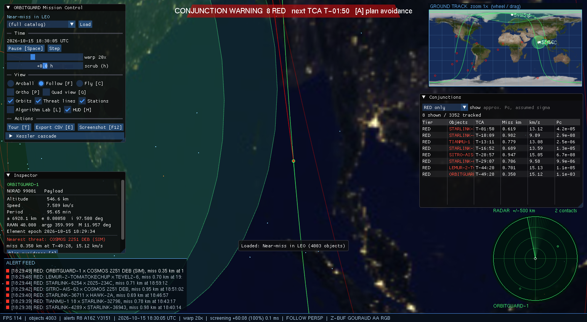
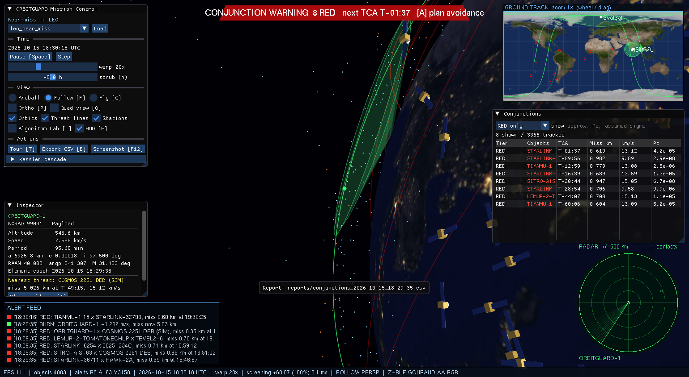
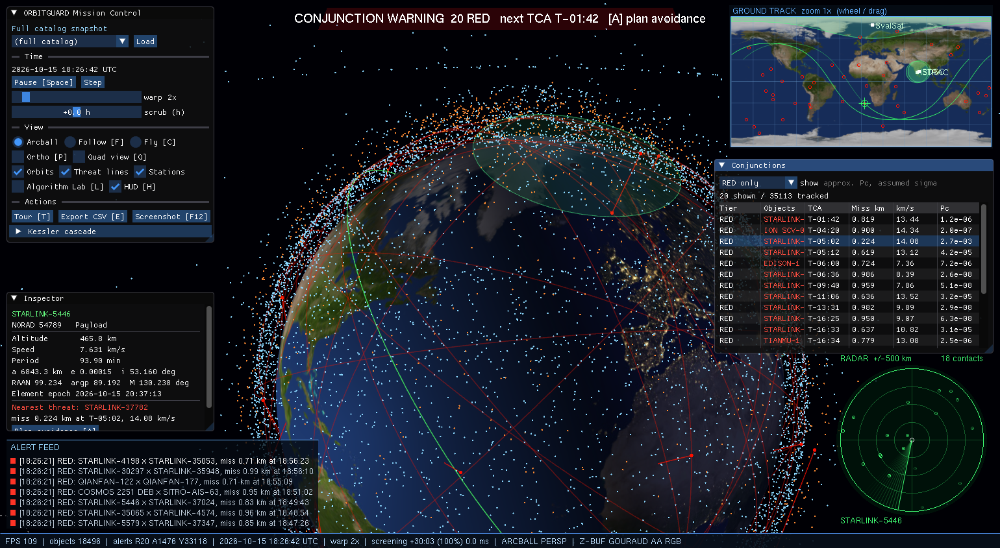

# ORBITGUARD: Mini-Project Report
**Course:** CS3002-1 Computer Graphics and Visualization (IPCC), NMAMIT Nitte
**Title:** Real-Time Space Situational Awareness: 3D Orbit, Debris Conjunction & Collision-Avoidance Console
**Platform:** C++17, OpenGL (fixed function), freeGLUT, Dear ImGui, CMake; Windows 11 / MSVC

---

## 1. Abstract
ORBITGUARD is a real-time 3D space situational awareness (SSA) console. It loads a real catalog
snapshot of 18,496 Earth-orbiting objects from Two-Line Element data. It propagates them with
Keplerian mechanics plus J2 secular perturbation, screens all of them for close approaches every
few frames, and plans minimum-Δv collision-avoidance burns. A Kessler mode turns unresolved
conjunctions into seeded fragment clouds that can trigger chain collisions.

The project is built to make the syllabus visible:
- The orbital-element-to-position pipeline is a composition of homogeneous rotation matrices.
- The mission-control HUD is scan-converted by hand-written midpoint, scan-line, clipping and
  Wu-antialiasing routines.
- An **Algorithm Lab** switches live between Z-buffer and painter's visible-surface determination,
  flat and Gouraud shading, aliased and antialiased lines, four color models, and wireframe
  hidden-line removal.

On a laptop with integrated graphics it renders the full catalog at about 95 FPS.

## 2. Objectives
1. Visualize the real orbital environment interactively in 3D (lit Earth, objects, orbits, stations).
2. Detect conjunctions between thousands of objects in real time and grade their risk.
3. Plan and visualize an avoidance maneuver that restores a safe miss distance without creating a new conjunction.
4. Simulate debris cascades (Kessler syndrome) reproducibly.
5. Implement and demonstrate the CS3002-1 algorithms by hand, inside a working application.

## 3. System architecture
```
           +-------------------- orbitguard.exe (OpenGL / GLUT / ImGui) ---------------------+
 input --> | app/  (GLUT callbacks, fixed-step clock, actions)                              |
           |   |-> render/ (Renderer, Camera, Lighting, Picking, Starfield)  --> 3D scene      |
           |   |-> hud/    (Viewport canvas, Radar, GroundTrackMap, AlertFeed, StatusBar)      |
           |   |-> ui/ lab/ (ImGui panels, Algorithm Lab)                                      |
           +---|------------------------------------------------------------------------------+
               v
           +----------- orbitguard_core.lib (no OpenGL, unit-tested) -------------------------+
           | io/     Config, Scenario (JSON), ReportExporter (CSV)                             |
           | ssa/    Simulation -> Screener(SpatialGrid, TCA) -> AvoidancePlanner, Kessler     |
           | orbit/  TLEParser, OrbitalElements (Kepler, frames), Propagator (SoA + J2)        |
           | math/ raster/ color/ geom/   own matrices, rasterizers, color models, curves, meshes |
           +-----------------------------------------------------------------------------------+
```
**Frame loop:**
1. Accumulate real time into fixed 50 Hz simulation ticks; each tick advances sim time by
   warp × 20 ms.
2. Propagate all objects.
3. Screen future time slices within a 6 ms budget.
4. Detect collisions.
5. Lerp render positions between the last two ticks.
6. Run the pick pass if a click is pending.
7. Draw the 3D scene, the HUD canvas and ImGui, then swap buffers.

## 4. Implementation of the graphics algorithms

### 4.1 Transformations (own `Mat4` / `Mat3`)
Matrices are column-major doubles: translate, scale, rotateX/Y/Z, axis-angle (Rodrigues), inverse,
perspective, ortho and lookAt. The renderer loads them with `glLoadMatrixd`, so OpenGL never builds
a transform itself.

The orbital chain maps a perifocal state to ECI with **R = Rz(Ω)·Rx(i)·Rz(ω)**. Satellite attitude
is a basis matrix: x along velocity, z radial. The HUD uses 3×3 homogeneous matrices for the radar
sweep (rotate then translate) and for window-to-viewport mapping (T(v₀)·S(s)·T(−w₀)). All of these
are verified against GLM to 1e-6.

### 4.2 Midpoint line and circle
Lines use integer decision-variable stepping along the major axis, so they work in all octants.
Circles compute one octant and mirror it eight ways. They draw the radar rings and sweep, the map
graticule and tracks, and the markers. Tests check endpoints, 8-connectivity, pixel counts and
symmetry.

### 4.3 Scan-line polygon fill
Edges are bucketed into an edge table by their first scanline. The active edge table is sorted by
x, and pixels between pairs of intersections are filled (even-odd rule, pixel-centre sampling).
Each edge's x is updated incrementally by 1/m, which is **coherence** along the edge. It fills HUD
panels, the warning banner, the radar disc and the station coverage footprints (including concave
and clipped ones).

### 4.4 Clipping
- **Cohen-Sutherland**: 4-bit outcodes give trivial accept or reject; otherwise the segment is
  intersected with one boundary at a time. It clips ground-track segments to the zoomable minimap,
  after they are split at the ±180° dateline.
- **Sutherland-Hodgman**: the polygon is clipped against each of the four edges in turn. It clips
  station footprints, which are drawn three times (offset −360°, 0, +360°) so they wrap around the
  map.

### 4.5 Antialiasing
**Xiaolin Wu** lines light two pixels per step, weighted by coverage, and are used in the HUD when
AA is on. In 3D, AA means MSAA plus `GL_LINE_SMOOTH` / `GL_POINT_SMOOTH`. The Lab toggles both, so
Wu and midpoint lines can be compared side by side on the radar sweep.

### 4.6 Projections and viewing
The camera supports arcball, follow and free-fly modes, with a perspective ⇄ orthographic toggle.
Quad view shows the same scene through a perspective view, a top orthographic view, a side
orthographic view and the 2D ground-track projection, each in its own `glViewport`.

### 4.7 Color models
RGB↔HSV, RGB↔YIQ (exact matrix inverse, so round trips are lossless) and RGB↔CMY are hand-written.
They are used for:
- the HSV risk gradient (hue 0° at a 0 km miss → 120° at 25 km)
- HSV altitude heatmap mode
- YIQ night-ops mode, which keeps only luminance Y
- CMY print preview, which quantizes ink to 4 levels on white

All non-data colors pass through one `applyColorMode()` function. The Earth textures are converted
once per mode when they load.

### 4.8 Meshes, curves, fractals
- **Meshes:** the Earth is a UV sphere with normals and texture coordinates; the satellite model is
  built from boxes and a paraboloid dish. Both are compiled into display lists.
- **Bezier:** a cubic de Casteljau arc is the maneuver transfer arc, from the burn point to a
  quarter orbit downstream on the new orbit.
- **B-spline:** a uniform cubic spline, clamped by repeating the end control points, drives the
  cinematic tour. Its control points are offsets from moving satellites.
- **Fractals:** debris rocks come from midpoint-displacement subdivision of an octahedron. Each
  level splits every face in four and displaces shared edge midpoints radially, with the amplitude
  shrinking by a roughness factor each level.

### 4.9 Illumination and shading
The sun is a directional `GL_LIGHT0` whose direction comes from a low-precision solar ephemeris
for the current sim time; the lighting is ambient + diffuse + specular. The day side is the
texture modulated by lighting. City lights are added in a second, additive pass, weighted per
vertex by clamp((0.08 − N·L)·4, 0, 1), which gives a soft terminator. The Lab toggles flat vs
Gouraud shading.

### 4.10 Visible-surface determination
- **Z-buffer** is the default.
- **Painter's (list priority):** the depth test is off. The Earth, every object point and every
  mesh are sorted by eye-space depth and drawn far to near, with back-face culling so the sphere
  does not overdraw itself. Its failure cases (limb pop-through, lines visible through the Earth)
  are the teaching point.
- **Hidden-line removal:** pass 1 fills polygons in the background color, pushed back with
  `glPolygonOffset`; pass 2 draws the edges with the depth test on.
- Translucent station cones are always depth-sorted, because blending depends on draw order.

### 4.11 Picking
Every object is rendered as a 7-pixel point whose color encodes `index+1` (24-bit). The Earth is
drawn as a black occluder, and `glReadPixels` reads a 9×9 window under the cursor, keeping the hit
nearest the centre. The self-test projects every isolated visible object with our own matrices and
checks the decoded ID. It scores 100% (104/104, 394/394 and 101/101 across runs).

## 5. Orbital mechanics and SSA algorithms

| Step | Method |
|---|---|
| TLE → elements | Fixed-column parse; mean motion → a = (μ/n²)^(1/3); epoch YYDDD.d → Julian date |
| Kepler's equation | Newton–Raphson, ≤ 10 iterations, residual ≤ 1e-15 |
| J2 | Secular Ω̇, ω̇ (spec §5 formulas) |
| Frames | ECI → ECEF via GMST; spherical-Earth lat/lon; elevation angle for station links |
| Broad phase | Time-sliced uniform grid. The cell is max(50, 15·slice/2 + 25 + 10) km, so any pair closer than 25 km during the slice shares or neighbors a cell. 27-cell neighborhood, apogee/perigee prefilter, parallel over cells, coherent incremental rehash |
| Narrow phase | Linear relative motion → bracket → golden-section search on the true distance → TCA, miss, relative speed |
| Risk | Tiers RED < 1 / AMBER < 5 / YELLOW < 25 km; approx. Pc = (R²/2σ²)·exp(−d²/2σ²) |
| Planner | Log-spaced ±Δv along-track (0.01–2 m/s), each re-screened against the threat and then the whole catalog; first feasible is minimal; Tsiolkovsky propellant |
| Kessler | n = clamp(8·v_rel², 200, 1000) fragments with Gaussian Δv (σ = 100 m/s), seeded RNG, re-entry cut, fragments screened against intact objects |

## 6. Results

### 6.1 Verification
| Check | Result |
|---|---|
| Own matrices vs GLM | max error < 1e-6 |
| Kepler residual | 8.9e-16 (≤ 9 iterations) |
| ISS period from TLE | 92.97 min (expected ≈ 92.9) |
| Grid broad phase vs brute force | all 126 close pairs found among 820 candidates (vs 1,999,000 all pairs) |
| Near-miss scenario | RED, TCA error 0.000 s, miss 0.350 km |
| Planner | −1.262 m/s → 5.03 km, 0.29 kg propellant; post-burn re-screen clean |
| Planner veto | a third object planted on the planned orbit is detected and the burn rejected |
| Kessler reproducibility | 2 collisions / 484 fragments / 961 alive, identical across runs |
| Picking | 100% of isolated visible objects |
| Clean build from scratch | dependencies fetched, 0 errors, 5/5 tests |

### 6.2 Performance (AMD Radeon integrated, 1540×845, Release)
| Scenario | Objects | FPS | Screening per 10 s slice |
|---|---|---|---|
| Full catalog, 60× | 18,496 | 94.7 | 8.4 ms |
| Full catalog, 600× | 18,496 | 74.7 | 7.7 ms |
| Constellation shell | 8,305 | 117 | 3.1 ms |
| LEO near miss | 4,003 | 109 | 1.4 ms |

The broad phase cuts pairwise checks from 1.7×10⁸ to about 2×10⁴ per slice. Propagating all
18,496 objects takes about 0.8 ms (OpenMP).

### 6.3 Screenshots
| | |
|---|---|
|  Full catalog, HUD and panels |  RED near-miss alert |
|  Avoidance plan: dashed old orbit, solid new orbit, Bezier arc |  After the burn: threat at 5.03 km |
|  Quad view (perspective / top / side / ground track) |  Kessler fragment cloud |
|  Painter's algorithm |  Wireframe + hidden-line removal, flat |
|  YIQ night-ops |  CMY print preview |
|  HSV altitude heatmap |  Cinematic B-spline tour |

## 7. Limitations
- Kepler + J2 secular only (no SGP4, drag or third-body), so the error grows to kilometres per day.
- The approximate Pc uses an assumed isotropic covariance.
- Along-track impulsive burns only, applied immediately.
- Screening exceeds 5 ms per slice above about 8k objects. At extreme warp the screener can fall
  behind, which shows as a coverage percentage below 100%.
- Simplified breakup model; fragment-fragment encounters are ignored.
- Verified on Windows only.

## 8. Future work
- SGP4/SDP4 propagation and real conjunction data messages (CDM) with covariance.
- Foster/Alfano Pc.
- Burn-time optimization and radial/normal maneuvers, plus station-keeping return burns.
- GPU compute screening, and per-shell velocity bounds to shrink the grid cells.
- GLSL per-pixel Phong shading compared against Gouraud in the Lab.
- A Warnock area-subdivision inspector.
- Live TLE refresh.

## 9. Conclusion
ORBITGUARD shows that the core graphics pipeline maps naturally onto a real aerospace problem:
- Transformation composition **is** orbital mechanics.
- Visible-surface and shading algorithms decide what an operator sees.
- Scan conversion, clipping and window-to-viewport mapping build the mission-control HUD.

The result is an interactive system that runs on modest hardware, in which every graded algorithm
can be seen and switched live.
